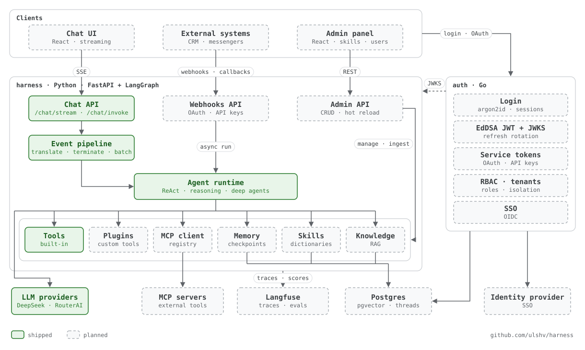
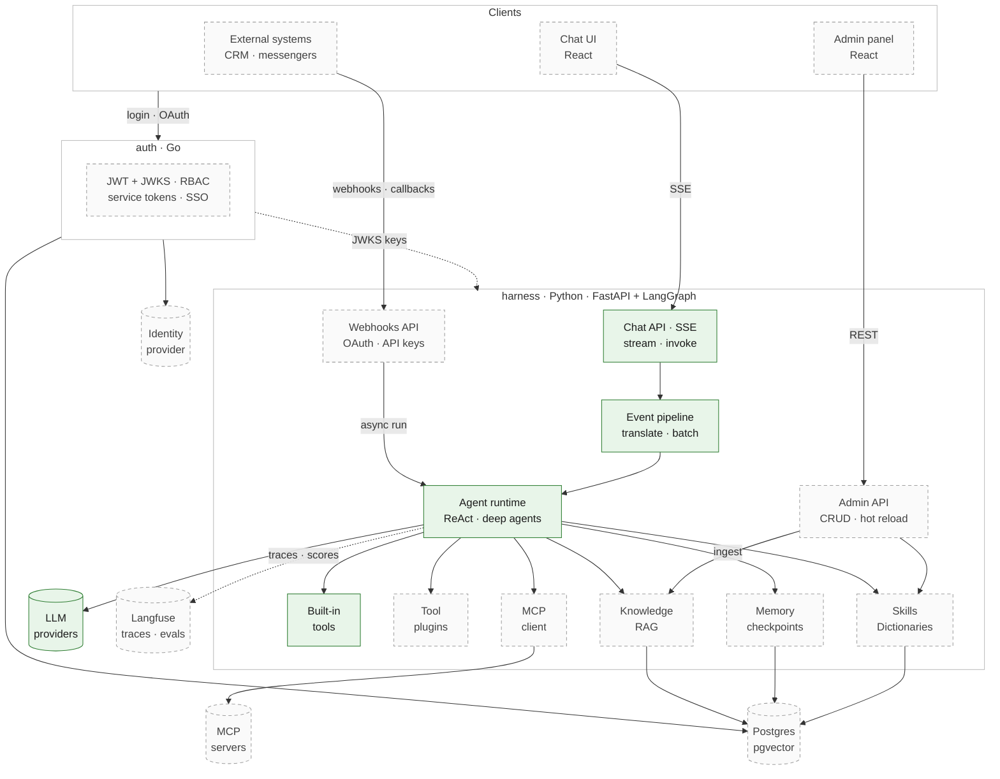

# harness

[English](README.md) · **Русский**

**Open-source основа для AI-агентов в продакшене.** Агент работает как полноценный сервис: стриминг,
тулзы, скиллы, MCP-интеграции, админка и взрослая авторизация. Это база, на которой энтерпрайз или
стартап строит собственный харнесс.


**Старт:** 14 октября 2026 · **Сделано шагов:** [6](docs/history) · **Live demo:** скоро

> **Статус: draft (в работе), не PoC.** Каждый сделанный шаг — продакшен-уровня: слоистый код,
> типизированные контракты, тесты, документация и отревьюенный дизайн. Фичи появляются по одной.

## Ремесло, а не вайб-кодинг

Нынешние coding LLM пишут как мидлы, которые выдают спагетти, если никто не следит за каждой строкой.
Многие проекты с AI-ассистентами сегодня работают по схеме «спека → план → AI-ревью». Но сам процесс не
делает код хорошим. Разницу делает ремесло, которое в него вкладывается.

Последние два года я строю харнессы для AI-агентов, которые работают в энтерпрайз-продакшене. Этот репозиторий —
то, как, по-моему, должна быть устроена основа такого харнесса. AI-инструменты ускоряют набор кода; я
ревьюю каждую строку и дорабатываю её до стандартов чистого кода.

## Каким он станет

- **Чат и админка (React).** Стриминговый чат с вызовами тулз и рассуждениями модели под спойлером. Админка
  для скиллов, интеграций, пользователей и ролей.
- **Библиотека скиллов.** Скиллы агента создаются и правятся в админке; агент подхватывает их без рестарта.
- **Кастомные тулзы как плагины.** Расширяют агента, не трогая его ядро.
- **Внешние MCP-интеграции.** Реестр MCP-серверов с кредами; агент находит их тулзы и вызывает.
- **Справочники.** Скиллы переносимы между окружениями: скилл ссылается на `{{crm.deal_amount}}`, а справочник
  каждого окружения говорит, что это там (`cf_12345` в одной CRM, `UF_CRM_AMOUNT` в другой).
  Один скилл — много инсталляций.
- **Серьёзная авторизация.** Микросервис на Go: пароли на argon2id, короткоживущие EdDSA JWT с проверкой через
  JWKS, ротация refresh-токенов, httpOnly cookie, затем RBAC. Позже — multi-tenancy и SSO.
- **Агенты, управляемые событиями.** Кроме чата, агента запускают внешние системы — CRM или мессенджер: они
  аутентифицируются по OAuth client credentials или API-ключам с ограниченными правами и вызывают вебхуки.
- **RAG.** Базы знаний из админки: загрузка документов, pgvector в Postgres, гибридный поиск и ответы со
  ссылками на источники. Для каждого тенанта своя.
- **Память, deep agents, наблюдаемость и evals.** Треды в Postgres, планирование и сабагенты. Трейсы и evals —
  в одном месте, в Langfuse: датасеты из реальных продовых трейсов, оценка LLM-as-judge и регрессионный
  контроль качества агента.

## Архитектура



Сплошная зелёная рамка — сделано. Пунктир — в планах.

<details>
<summary>Mermaid-версия</summary>



</details>

- **harness** (Python): runtime агента. Три входа: чат по SSE (через конвейер событий: перевод вывода
  графа → финальное `done`/`error` → батчинг), API админки и вебхуки от внешних систем, которые запускают
  асинхронные прогоны и получают результат через callback.
- **auth** (Go): выдаёт токены людям (логин, SSO) и системам (OAuth client credentials, API-ключи).
  harness проверяет их локально по JWKS и не ходит в auth на каждый запрос.
- **Клиенты**: React-чат и админка, а также внешние системы — CRM, мессенджеры.

Подробный разбор — в [`docs/arch/001_chat-request-flow.md`](docs/arch/001_chat-request-flow.md) (на английском).

## Roadmap

**Сделано**

- [x] Основа: монорепо, dev-цикл на Docker Compose с hot reload, healthcheck'и
- [x] ReAct-агент на LangGraph с тулзами, настраиваемый OpenAI-совместимый провайдер
- [x] SSE-стриминг: от PoC к продакшен-раскладке — слоистый API, типизированные события, валидация конфига на старте
- [x] `/chat/stream` и `/chat/invoke` на одном конвейере; батчинг текста (в ~10 раз меньше кадров)
- [x] Финальные события `done` / `error` с безопасными кодами ошибок и защитой от зацикливания
- [x] Живой стрим `reasoning`

**Дальше**, в порядке сборки

- [ ] React-чат: стриминг, вызовы тулз, рассуждения под спойлером
- [ ] Память: треды разговоров, Postgres-checkpointer
- [ ] Deep agents: планирование, виртуальная файловая система, сабагенты; todo-лист агента в UI
- [ ] Сервис авторизации на Go: argon2id, EdDSA JWT + JWKS, ротация refresh-токенов
- [ ] RBAC и админка
- [ ] Библиотека скиллов: управление из админки, hot reload
- [ ] Кастомные тулзы как плагины
- [ ] Внешние MCP-интеграции: реестр серверов, креды
- [ ] Справочники: переносимые скиллы со значениями под каждое окружение
- [ ] RAG: базы знаний, pgvector, гибридный поиск, ссылки на источники в чате
- [ ] Наблюдаемость: трейсы агента в Langfuse, trace-id через все сервисы
- [ ] Evals в Langfuse: датасеты из продовых трейсов, LLM-as-judge, регрессионный контроль в CI
- [ ] Multi-tenancy

**Позже**

- [ ] Kubernetes: те же сервисы и тот же dev-цикл с hot reload, через kind/minikube + Tilt
- [ ] SSO / OAuth (OIDC)
- [ ] Входящие вебхуки: внешние системы запускают агента, аутентифицируясь по OAuth client credentials или API-ключам
- [ ] Live demo

Основа остаётся open source; часть энтерпрайз-возможностей может поставляться отдельно. Рабочий roadmap
с бэклогом и причинами каждого пункта — в [`docs/ROADMAP.md`](docs/ROADMAP.md) (на английском).

## Что он умеет сегодня

Один реальный запрос: модель думает, вызывает тулзу, думает снова уже с результатом, отвечает и явно
закрывает стрим (повторяющиеся кадры сокращены).

```bash
curl -N localhost:8000/chat/stream -H 'content-type: application/json' \
  -d '{"message":"How many minutes are left until midnight UTC?"}'
```

```
event: reasoning
data: {"text":"We need"}

event: reasoning
data: {"text":" answer needs current time. Use tool."}

event: tool_call
data: {"id":"call_00_qJxXBvCuuGrvvrCFXHIr9647","name":"current_time","args":{}}

event: tool_result
data: {"tool_call_id":"call_00_qJxXBvCuuGrvvrCFXHIr9647","name":"current_time","content":"2026-10-14T20:04:19+00:00"}

event: reasoning
data: {"text":"Current time"}

… ещё 6 кадров reasoning: модель считает

event: text
data: {"text":"At 20:04:19 UTC, there are **"}

… ещё 3 кадра text

event: done
data: {}
```

- **ReAct-агент на LangGraph** за FastAPI, с любым OpenAI-совместимым провайдером. По умолчанию — DeepSeek
  через RouterAI.
- **Один конвейер событий, два эндпоинта.** `/chat/stream` отдаёт SSE; `/chat/invoke` возвращает те же
  события, склеенные в один JSON. Тесты получаются точными, а UI и API не расходятся между собой.
- **Типизированный контракт событий** (`reasoning`, `text`, `tool_call`, `tool_result`, `done`, `error`)
  опубликован в OpenAPI как discriminated union — готов к генерации клиента для фронтенда.
- **Живые рассуждения.** Время до первого кадра сократилось с ~11.6 с тишины до ~1.4 с.
- **Безопасные ошибки.** Каждый стрим заканчивается `done` или `error`. Коды ошибок отделяют временные сбои
  провайдера, которые лечатся повтором, от нашей собственной ошибки конфигурации, а детали остаются в логах.
- **Dev-цикл, который просто работает.** `make up` поднимает Docker Compose с hot reload; `make test` и
  `make lint` запускают проверки. Юнит-тесты — на детерминированных фейковых моделях, живая модель — только в смоук-тестах.

## Быстрый старт

Нужны Docker с Compose ≥ 2.22, `make` и [`uv`](https://docs.astral.sh/uv/) для локального запуска тестов.

```bash
git clone https://github.com/ulshv/harness.git && cd harness
cp .env.example .env        # задайте LLM_API_KEY (любой OpenAI-совместимый эндпоинт; по умолчанию RouterAI + DeepSeek)
make up                     # docker compose up --watch: правите код — сервис перезагружается
curl -N localhost:8000/chat/stream -H 'content-type: application/json' -d '{"message":"hi"}'
make test && make lint
```

OpenAPI UI — на `localhost:8000/docs`.

## Как это устроено

Документация в `docs/` — на английском.

| Где | Что |
|---|---|
| [`docs/specs/`](docs/specs) | спека на каждый шаг, пишется до кода: проблема, решения, компромиссы |
| [`docs/history/`](docs/history) | что изменил каждый шаг, как это проверить, найденные gotcha, итоги ревью |
| [`docs/arch/`](docs/arch) | как система работает сейчас |
| [`docs/ROADMAP.md`](docs/ROADMAP.md) | продуктовые шаги, ближайшие планы, бэклог с причинами каждого пункта |

**Стек:** Python 3.14, FastAPI, LangGraph, LangChain, pydantic, uv, pytest, ruff · Go (auth) ·
React + Vite + TypeScript · Postgres · Docker Compose, позже Kubernetes.

## Лицензия

[Apache-2.0](LICENSE)
