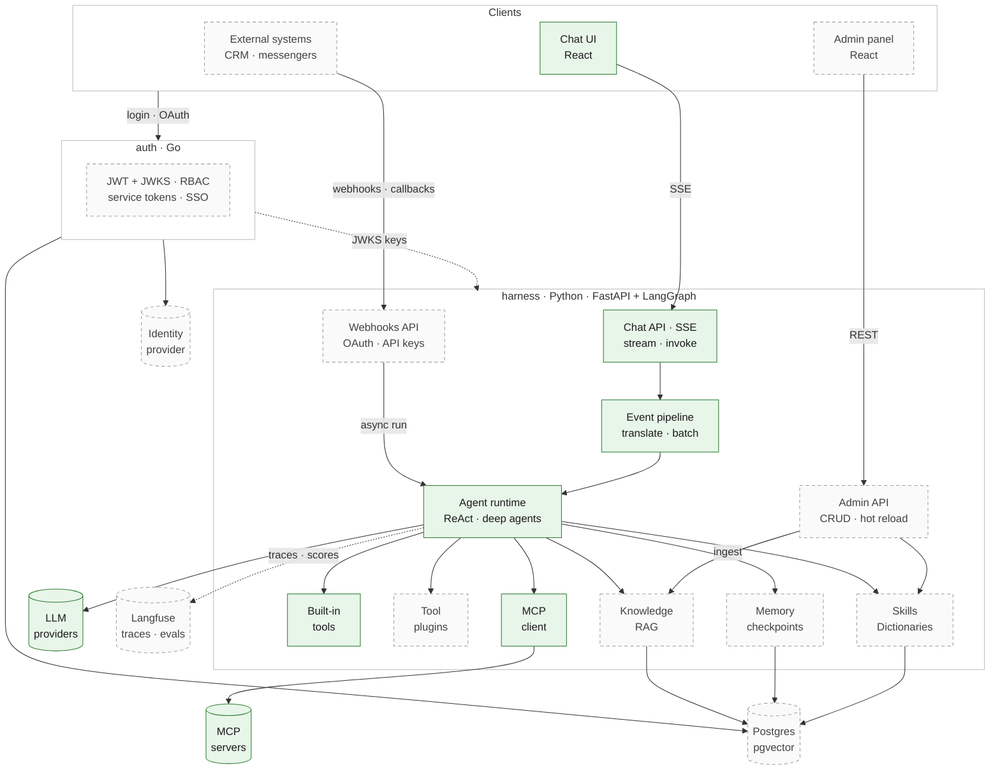

# harness

**English** · [Русский](README-ru.md)

**An open-source foundation for building AI agents for enterprises and startups.** It includes SSE streaming,
tools, skills, MCP integration, a web app, an admin panel, a dedicated auth service and more to come! (see [Roadmap](#roadmap))

I've spent the last two years building AI agent harnesses that run in enterprise production. This project is
how I think the foundation of such a harness should be built.

**Started:** October 14th, 2026 · **Steps shipped:** [11](docs/history) · **Live demo:** coming soon

> **Status: draft (work in progress), not a PoC.** Every shipped step is production-grade: layered code,
> typed contracts, tests, docs and a reviewed design. Features land one at a time.

## Crafted, not vibe-coded

Today's coding LLMs write like mid-level developers who ship spaghetti unless someone watches every line.
Plenty of AI-assisted projects now follow a "spec → plan → AI review" flow. The process alone doesn't
make the code good. What makes the difference is the craft that goes into it.

AI tools speed up the typing; I review every line and rework the core until it meets clean-code standards.

Not every line gets the same treatment though... The core (the agent runtime in `services/harness`, the auth service
in `services/auth`) and the infrastructure go through strict review: I clean up and rework the assistant's code
until I'd put my name on every line. The supporting code (the chat UI in `services/webapp`, the testing
warehouse API and its MCP server, unit tests) is reviewed and fixed where it matters, but not polished to the
same standard: it has to be correct and readable, not elegant.

## Quick start

Requires Docker with Compose ≥ 2.22, `make`, and [`uv`](https://docs.astral.sh/uv/) for running tests locally.

1. `git clone https://github.com/ulshv/harness.git && cd harness`
2. `cp .env.example .env`
3. Fill in the variables: at least `LLM_API_KEY` (any OpenAI-compatible endpoint; defaults: RouterAI + DeepSeek).
4. `make up` starts all services with hot reload.
5. Open http://localhost:8080.
6. Start chatting! Ask the agent what it can do.

The OpenAPI UI is at `localhost:8000/docs`; `make test && make lint` runs the checks.

Under the hood:

- **Streaming chat.** The answer streams in as Markdown; reasoning and tool calls fill a live block that folds
  into a one-line summary once the answer starts.
- **A LangGraph ReAct agent** with any OpenAI-compatible provider (default: DeepSeek via RouterAI).
- **MCP tools.** Tools from MCP servers join the agent at startup; a dead server or a failing tool never kills a run.
- **One typed event contract** for `/chat/stream` (SSE) and `/chat/invoke` (JSON), published in OpenAPI. Every
  stream ends with `done` or `error`.

## Architecture

Solid green: shipped. Dashed: planned.

Mermaid version

- **harness** (Python): the agent runtime. Three ways in: chat over SSE (through the event pipeline:
  translate graph output → append `done`/`error` → batch), the admin API, and webhooks from external systems,
  which start async runs and get results back via callbacks.
- **auth** (Go): issues tokens to people (login, SSO) and to systems (OAuth client credentials, API keys).
  harness verifies them locally via JWKS and never calls auth per request.
- **Clients**: the React chat and admin panel, plus external systems such as a CRM or a messenger.

A deeper walkthrough is in [`docs/arch/001_chat-request-flow.md`](docs/arch/001_chat-request-flow.md).

## What it's becoming

- **Chat UI and admin panel (React).** Streaming chat with tool calls and reasoning in a spoiler. Admin for
  skills, integrations, users and roles.
- **Skills library.** Create and edit agent skills from the admin panel; the agent picks them up without a restart.
- **Custom tools as plugins.** Extend the agent without touching its core.
- **External MCP integrations.** A registry of MCP servers with credentials; the agent discovers and calls
  their tools.
- **Dictionaries.** Skills stay portable across environments: a skill refers to `{{crm.deal_amount}}`, and each
  environment's dictionary says what that is there (`cf_12345` in one CRM, `UF_CRM_AMOUNT` in another).
  One skill, many installations.
- **Serious auth.** A Go microservice with argon2id passwords, short-lived EdDSA JWTs verified via JWKS,
  refresh-token rotation, httpOnly cookies, then RBAC. Multi-tenancy and SSO come later.
- **Event-driven agents.** Beyond chat, external systems such as a CRM or a messenger authenticate with OAuth
  client credentials or scoped API keys and trigger the agent through webhook endpoints.
- **RAG.** Knowledge bases managed from the admin panel: ingestion, pgvector in Postgres, hybrid search, and
  answers with citations. Per tenant.
- **Memory, deep agents, observability and evals.** Threads in Postgres, planning and subagents. Traces and
  evals live in one place, Langfuse: datasets built from real production traces, LLM-as-judge scoring, and a
  regression gate for agent quality.

## Roadmap

**Shipped**

- [x] Foundation: monorepo, Docker Compose dev loop with hot reload, health checks
- [x] LangGraph ReAct agent with tools, configurable OpenAI-compatible provider
- [x] SSE streaming, from PoC to a production layout: layered API, typed events, fail-fast config
- [x] `/chat/stream` and `/chat/invoke` on one pipeline; text batching (~10× fewer frames)
- [x] Terminal `done` / `error` events with safe error codes and a recursion guard
- [x] Live `reasoning` stream
- [x] Conversations by `thread_id` (in memory for now)
- [x] MCP client: tools from MCP servers join the agent at startup; a dead server or a failing tool never kills a run
- [x] A testing warehouse for evals: a REST API with deliberate traps and an MCP server over it
- [x] React chat: streaming Markdown answer, live reasoning and tool calls, conversations

**Next**, in build order

- [ ] Memory: Postgres checkpointer, conversations survive restarts
- [ ] Deep agents: planning, virtual filesystem, subagents, with the agent's todo list in the UI
- [ ] Auth service in Go: argon2id, EdDSA JWT + JWKS, refresh rotation
- [ ] RBAC and the admin panel
- [ ] Skills library, managed from the admin panel and hot-reloaded
- [ ] Custom tools as plugins
- [ ] External MCP integrations: server registry, credentials
- [ ] Dictionaries: portable skills with per-environment values
- [ ] RAG: knowledge bases, pgvector, hybrid search, citations in the chat
- [ ] Observability: agent traces in Langfuse, trace-id across services
- [ ] Evals in Langfuse: datasets from production traces, LLM-as-judge, a regression gate in CI
- [ ] Multi-tenancy

**Later**

- [ ] Kubernetes: the same services and the same hot-reload dev loop, via kind/minikube + Tilt
- [ ] SSO / OAuth (OIDC)
- [ ] Inbound webhooks: external systems trigger agent runs, authenticated with OAuth client credentials or API keys
- [ ] Live demo

The foundation stays open source; some enterprise capabilities may ship separately. The working roadmap,
with the backlog and its reasons, is in [`docs/ROADMAP.md`](docs/ROADMAP.md).

## How it's built

| Where | What |
|---|---|
| [`docs/specs/`](docs/specs) | a spec per step, written before code: problem, decisions, trade-offs |
| [`docs/history/`](docs/history) | what each step changed, how to verify it, gotchas found, review takeaways |
| [`docs/arch/`](docs/arch) | how the system works today |
| [`docs/ROADMAP.md`](docs/ROADMAP.md) | product steps, next up, backlog with the reasons for each item |

**Stack:** Python 3.14, FastAPI, LangGraph, LangChain, pydantic, uv, pytest, ruff · Go (auth) ·
React + Vite + TypeScript · Postgres · Docker Compose, later Kubernetes.

## License

[Apache-2.0](LICENSE)
